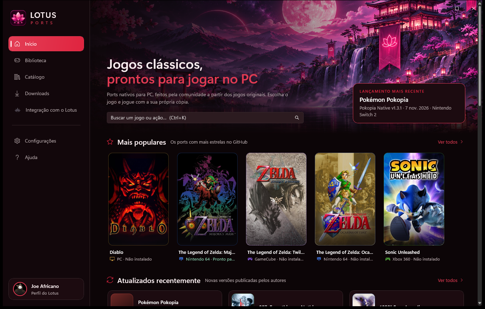
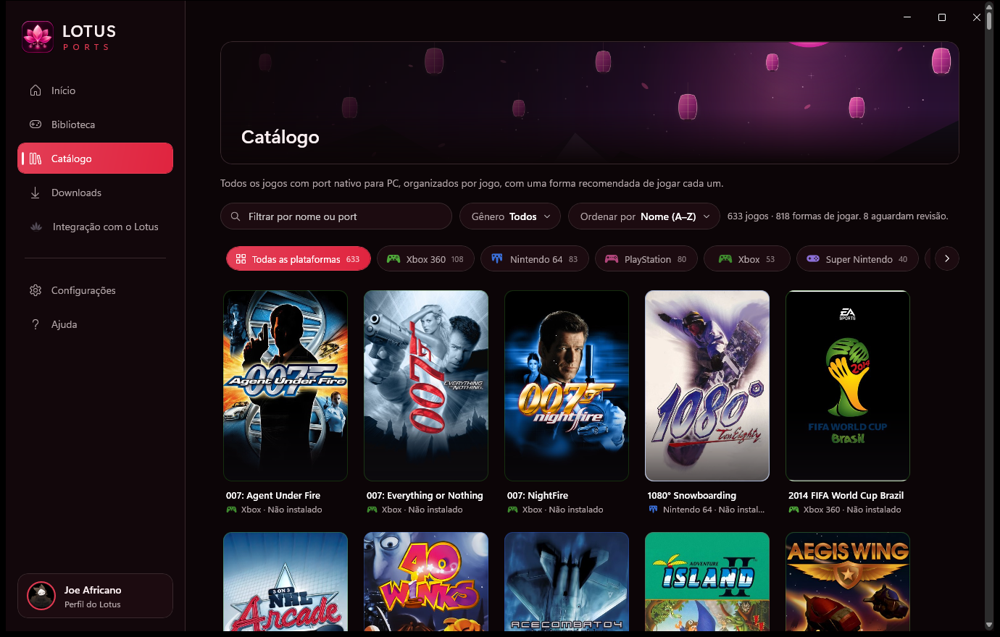
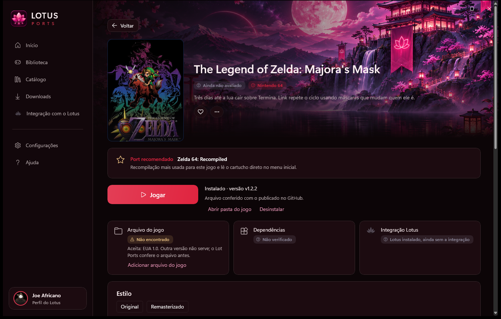
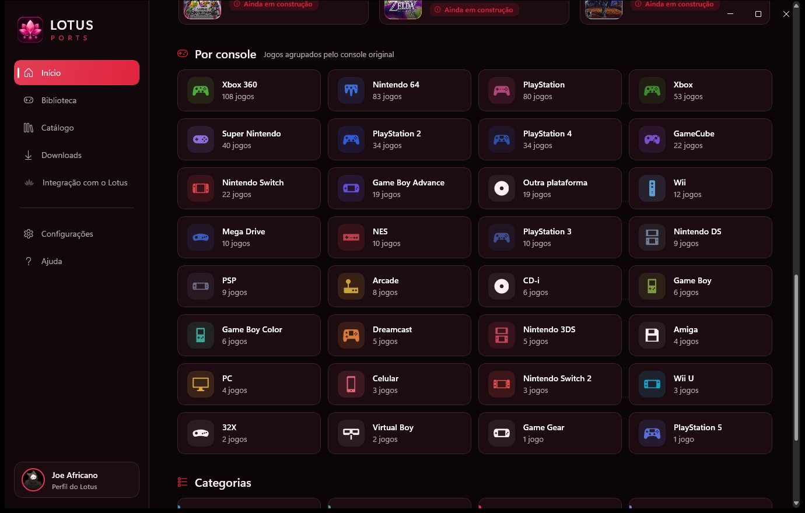
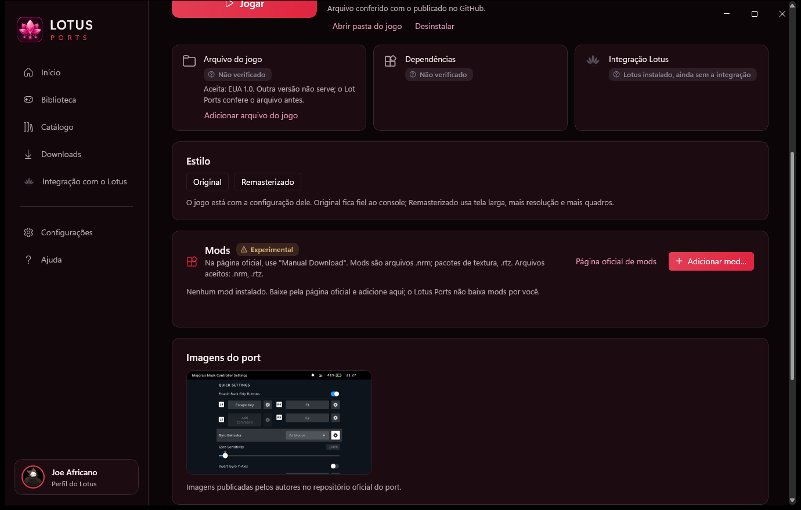
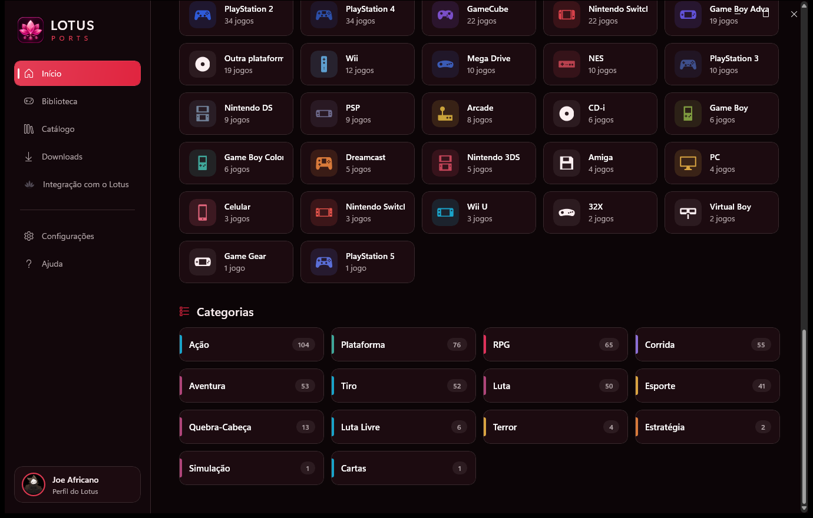
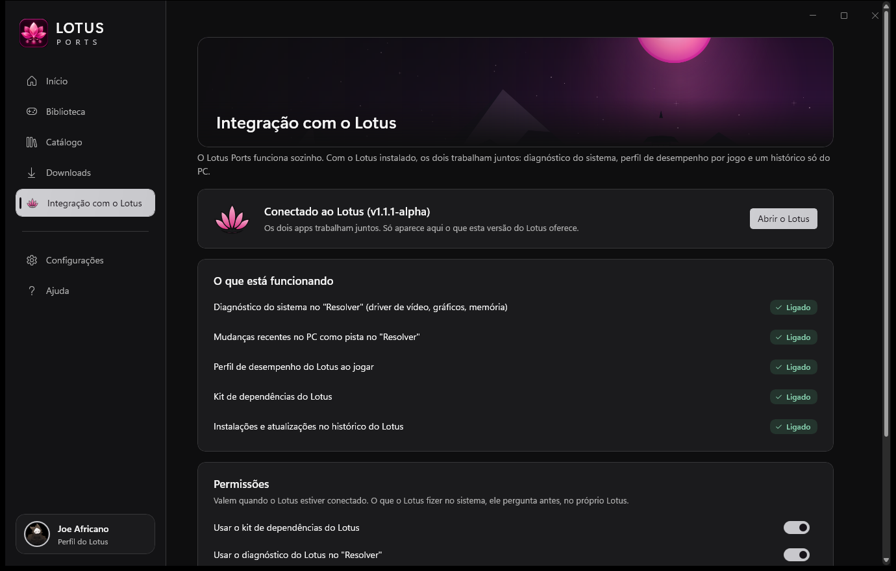

<div align="center">


# Lotus Ports

**Seus clássicos, rodando nativos no PC.**

Escolha um jogo e o Lotus Ports cuida do resto: instala o port certo, confere tudo, mantém atualizado e abre o jogo num clique.

[](../../releases)


[](LICENSE)

[**⬇ Baixar o instalador**](../../releases) · [Novidades](CHANGELOG.md) · [Como funciona](#como-funciona) · [Perguntas](#perguntas-frequentes)



</div>

> [!WARNING]
> **Versão alpha, em pré-teste.** O Lotus Ports ainda está sendo testado e pode ter falhas, telas incompletas e mudanças a cada versão. Use com calma, mantenha cópias dos seus saves importantes e conte o que encontrar em [Issues](../../issues). As atualizações chegam sozinhas pelo próprio app.

---

## O que é

Muitos jogos de console ganharam versões **nativas para PC** feitas pela comunidade: descompilações, recompilações estáticas e remakes de motor. Rodam sem emulador, com tela larga, mais quadros e mods. O difícil é achar cada um, saber qual usar, instalar, atualizar e configurar.

O Lotus Ports junta tudo num lugar só, pensado para quem só quer jogar.

| | |
|---|---|
| 🎮 **Mais de 640 jogos** | Organizados pelo jogo (não pelo nome técnico do projeto), cada um com a forma recomendada de jogar. |
| ▶️ **Um botão só** | Instalar → Jogar → Atualizar → Resolver. |
| 🔒 **Tudo conferido** | Cada arquivo baixado é comparado com o publicado no GitHub antes de instalar. |
| 💾 **Seu arquivo do jogo** | Reconhecido pela assinatura, até dentro de um `.zip`. A página mostra qual versão o port aceita. |
| 🔄 **Sempre atualizado** | Ports e o próprio app se atualizam sozinhos. A versão anterior fica guardada para voltar com um clique. |
| 🎨 **Original ou Remasterizado** | Opções reais de cada port, com backup e "Desfazer". |
| 🧩 **Mods** | Em arquivo ou em pasta, sempre com backup. |
| 🩺 **Resolver** | Quando um jogo não abre, mostra a causa provável e oferece voltar a versão. |
| 🇧🇷 **Em português** | Instruções de todos os ports traduzidas. |

## Telas

<table>
<tr>
<td width="50%"><br/><b>Catálogo</b>: filtro por plataforma com ícones, gênero e ordem.</td>
<td width="50%"><br/><b>Página do jogo</b>: port recomendado, versão aceita e um botão para jogar.</td>
</tr>
<tr>
<td><br/><b>Por console</b>: cada plataforma com o seu ícone.</td>
<td><br/><b>Estilos, mods e imagens do port</b>.</td>
</tr>
<tr>
<td><br/><b>Categorias</b>: explore por gênero.</td>
<td><br/><b>Integração com o Lotus</b>: diagnóstico, sessões e FPS.</td>
</tr>
</table>

## Integração com o Lotus

O Lotus Ports funciona sozinho. Com o [**Lotus**](https://github.com/JoeAfricano/Lotus) instalado, os dois trabalham juntos:

- diagnóstico do PC no "Resolver" (driver de vídeo, Vulkan, memória e disco);
- os seus jogos do Lotus Ports aparecem em Meus Jogos no Lotus, com o botão Jogar;
- sessões de jogo e o selo "Funciona no seu PC", com o FPS medido pelo Lotus.

## Instalação

1. Baixe o `LotusPorts-Setup-*.exe` mais recente em [Releases](../../releases).
2. Execute. A instalação é **por usuário** e não pede administrador.
3. Abra o Lotus Ports pelo menu Iniciar ou pelo atalho na Área de Trabalho.

**Requisitos:** Windows 10 (19041) ou 11, 64 bits. Cada port pode ter requisitos próprios (por exemplo Vulkan 1.3), e a página do jogo mostra quais são.

**Atualizações:** o app verifica as Releases deste repositório uma vez por dia. O instalador novo só roda depois que o SHA-256 confere com o do GitHub. Versões de teste (alpha) chegam para quem está numa versão de teste.

> O Windows pode mostrar "O Windows protegeu o computador" na primeira instalação, porque o instalador ainda não tem assinatura digital. Clique em **Mais informações → Executar assim mesmo**.

## Como funciona

| Etapa | O que acontece |
|---|---|
| **Catálogo** | Lista revisada de jogos e ports, com evidências: release, tamanho e hash de cada arquivo. Ports novos e ainda não conferidos aparecem como **Experimental**. |
| **Instalar** | Baixa a release oficial do port no GitHub, confere o SHA-256 e instala em `%LOCALAPPDATA%\LotusPorts\library`. Um download por vez. |
| **Arquivo do jogo** | Você aponta a sua cópia (ou o `.zip` dela). O app reconhece pela assinatura e, nos ports que leem da própria pasta, coloca o arquivo no lugar certo. |
| **Atualizar** | Versões novas são instaladas ao lado da anterior; "Voltar para a versão anterior" desfaz. |
| **Diário** | Toda operação (instalar, estilo, mod) fica registrada com ANTES e DEPOIS. |

## Perguntas frequentes

**O Lotus Ports baixa jogos?**
Não. Ele não fornece, não baixa e não indica onde obter arquivos de jogos, BIOS, firmware ou chaves. Você usa a sua própria cópia.

**É um emulador?**
Não. Os ports são programas nativos para Windows, feitos pela comunidade a partir dos jogos originais.

**O que significa "Experimental"?**
É um port novo, ainda não conferido pela curadoria, que pode ter falhas.

**Meus saves estão seguros?**
Saves em pastas do Windows nunca são tocados. Saves dentro da pasta do jogo seguem para a versão nova, e a versão anterior fica guardada com os dela. Mesmo assim, por ser alpha, mantenha cópias dos saves importantes.

## Desenvolvimento

Requisitos: Windows 10 19041+ x64, .NET SDK 10 e, para o instalador, Inno Setup 6.

```
dotnet build LotusPorts.slnx -p:Platform=x64
dotnet test LotusPorts.slnx -p:Platform=x64
powershell -ExecutionPolicy Bypass -File tools\Build-Installer.ps1
```

| Pasta | Conteúdo |
|---|---|
| `src/LotusPorts.App` | Interface WinUI 3 (MVVM). |
| `src/LotusPorts.Core`, `Infrastructure`, `Catalog` | Regras, instalação, diário, GitHub, catálogo. |
| `src/LotusPorts.Integration`, `Lotus.Integration.Contracts` | Protocolo com o Lotus (named pipes, JSON-RPC). |
| `src/Lotus.Design` | Tema, ícones de plataforma e controles visuais. |
| `catalog/` | Jogos, ports, guias em português e o pacote embutido. |
| `tools/CatalogScout` | Ferramenta da curadoria (varredura, capas, revisão e empacotamento). |
| `docs/` | Arquitetura, UX, integração, catálogo e pendências. |

## Aviso

O Lotus Ports não é afiliado a fabricantes de consoles, publishers ou aos autores dos ports. Nomes, marcas e capas pertencem aos respectivos donos; as capas são carregadas na hora de fontes públicas e não fazem parte deste repositório. Cada port tem a sua própria licença, indicada na página do jogo.

## Licença

[MIT](LICENSE) © 2026 JoeAfricano
