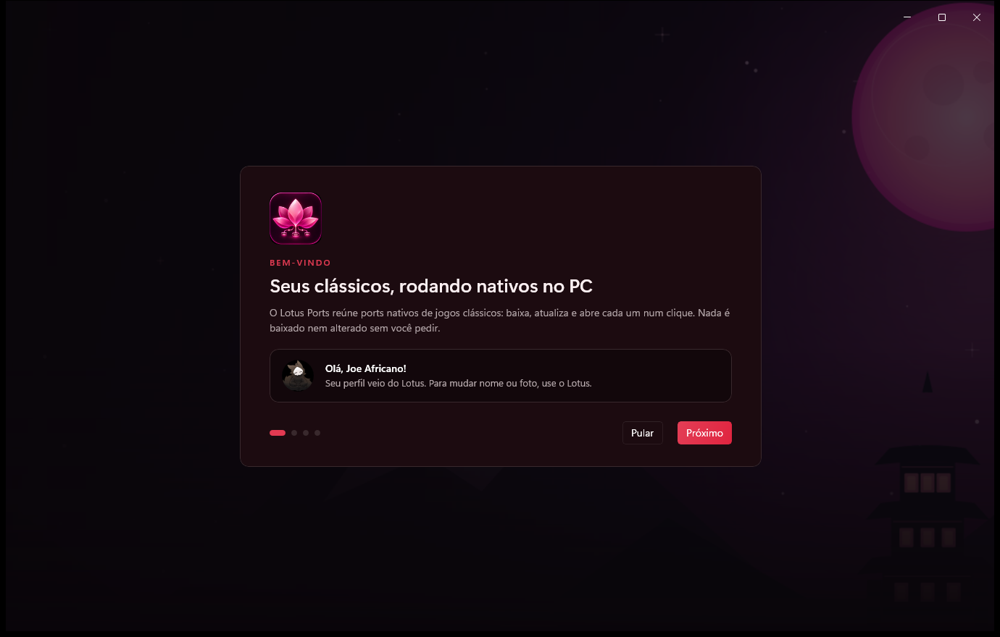
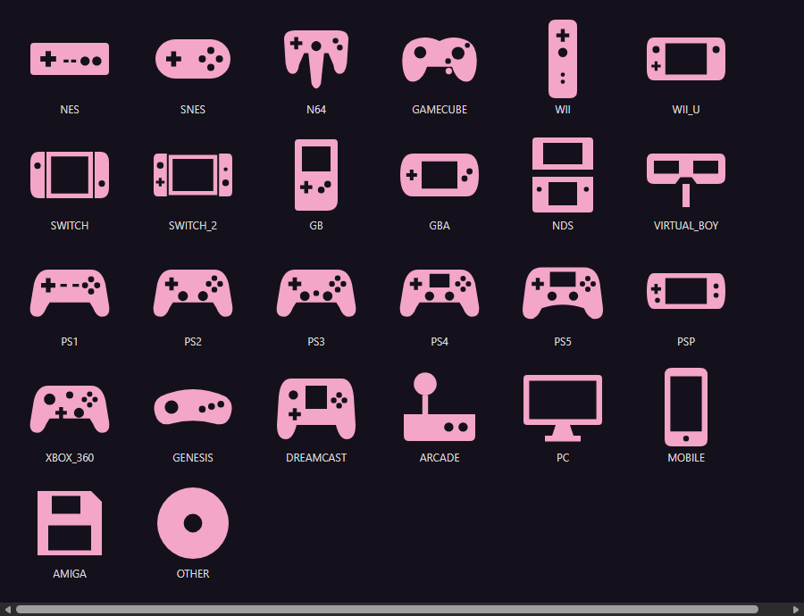

<div align="center">


# Lotus Ports

**Seus clássicos, rodando nativos no PC.**

Escolha um jogo, e o Lotus Ports cuida do resto: instala o port certo, confere tudo, mantém atualizado e abre o jogo num clique.


[**Baixar o instalador**](../../releases/latest) · [Novidades](CHANGELOG.md) · [Como funciona](#como-funciona) · [Perguntas](#perguntas-frequentes)



</div>

---

## O que é

Muitos jogos de console ganharam versões **nativas para PC** feitas pela comunidade: descompilações, recompilações estáticas e remakes de motor. Eles rodam sem emulador, com tela larga, mais quadros e mods. O problema é achar cada um, saber qual usar, instalar, atualizar e configurar.

O Lotus Ports junta tudo num lugar só, pensado para quem só quer jogar:

- **Mais de 640 jogos no catálogo**, organizados pelo jogo, não pelo nome técnico do projeto, cada um com a forma recomendada de jogar.
- **Um botão só:** Instalar → Jogar → Atualizar → Resolver.
- **Tudo conferido:** o arquivo baixado é comparado com o publicado no GitHub antes de instalar.
- **O seu arquivo do jogo é reconhecido**, até dentro de um `.zip`. A página mostra qual versão o port aceita, para você não escolher a errada.
- **Atualizações automáticas** dos ports instalados. A versão anterior fica guardada para voltar com um clique.
- **Estilos Original e Remasterizado**, com as opções reais de cada port, sempre com backup e "Desfazer".
- **Mods** para os ports que aceitam, em arquivo ou em pasta, sempre com backup.
- **"Resolver"** quando um jogo não abre: ele mostra a causa provável e oferece voltar a versão.
- **Instruções em português** para todos os ports.

## Integração com o Lotus

O Lotus Ports funciona sozinho. Com o [**Lotus**](https://github.com/JoeAfricano/Lotus) instalado, os dois trabalham juntos:

- diagnóstico do PC no "Resolver" (driver de vídeo, Vulkan, memória e disco);
- os seus jogos do Lotus Ports aparecem em Meus Jogos no Lotus, com o botão Jogar;
- sessões de jogo e medição de FPS, quando você permite.

<div align="center"></div>

## Organização por plataforma

Cada console tem um ícone próprio, desenhado para o app (silhuetas originais, sem logotipos de marca). Filtre o catálogo e a biblioteca com um clique.

<div align="center"></div>

## Instalação

1. Baixe o `LotusPorts-Setup-0.1.0-alpha.exe` em [Releases](../../releases/latest).
2. Execute. A instalação é **por usuário** e não pede administrador.
3. Abra o Lotus Ports pelo menu Iniciar.

**Requisitos:** Windows 10 (19041) ou 11, 64 bits. Cada port pode ter requisitos próprios (por exemplo Vulkan 1.3), e a página do jogo mostra quais são.

O app se atualiza sozinho pelas Releases deste repositório. A verificação é diária, e o instalador novo só roda depois que o SHA-256 confere com o do GitHub.

## Como funciona

| Etapa | O que acontece |
|---|---|
| **Catálogo** | Lista revisada de jogos e ports, com evidências: release, tamanho e hash de cada arquivo. Jogos novos só aparecem depois de revisados. |
| **Instalar** | Baixa a release oficial do port no GitHub, confere o SHA-256 e instala em `%LOCALAPPDATA%\LotusPorts\library`. Nada fora dessa pasta é alterado. |
| **Arquivo do jogo** | Você aponta a sua cópia (ou o `.zip` dela). O app reconhece pela assinatura (SHA-1/MD5) e diz se é a versão certa. |
| **Atualizar** | Versões novas são instaladas ao lado da anterior. Os saves dentro da pasta do jogo seguem junto, e "Voltar para a versão anterior" desfaz. |
| **Diário** | Toda operação (instalar, estilo, mod) fica registrada com ANTES e DEPOIS. |

## Perguntas frequentes

**O Lotus Ports baixa jogos?**
Não. Ele não fornece, não baixa e não indica onde obter arquivos de jogos, BIOS, firmware ou chaves. Você usa a sua própria cópia.

**É um emulador?**
Não. Os ports são programas nativos para Windows, feitos pela comunidade a partir dos jogos originais.

**O que significa "Experimental"?**
É um port novo, ainda não conferido pela curadoria, que pode ter falhas. Ele aparece marcado na página do jogo.

**Meus saves estão seguros?**
Saves em pastas do Windows nunca são tocados. Saves dentro da pasta do jogo seguem para a versão nova, e a versão anterior fica guardada com os dela.

## Desenvolvimento

Requisitos: Windows 10 19041+ x64, .NET SDK 10 e, para o instalador, Inno Setup 6.

```
dotnet build LotusPorts.slnx -p:Platform=x64
dotnet test LotusPorts.slnx -p:Platform=x64
powershell -ExecutionPolicy Bypass -File tools\Build-Installer.ps1
```

| Pasta | Conteúdo |
|---|---|
| `src/LotusPorts.App` | Interface WinUI 3 (MVVM). |
| `src/LotusPorts.Core`, `Infrastructure`, `Catalog` | Regras, instalação, diário, GitHub, catálogo. |
| `src/LotusPorts.Integration`, `Lotus.Integration.Contracts` | Protocolo com o Lotus (named pipes, JSON-RPC). |
| `src/Lotus.Design` | Tema, ícones e controles visuais compartilhados com o Lotus. |
| `catalog/` | Jogos, ports, guias em português e o pacote embutido. |
| `tools/CatalogScout` | Ferramenta da curadoria (varredura, revisão e empacotamento). |
| `docs/` | Arquitetura, UX, integração, catálogo e pendências. |

## Aviso

O Lotus Ports não é afiliado a fabricantes de consoles, publishers ou aos autores dos ports. Nomes e marcas pertencem aos respectivos donos. Cada port tem a sua própria licença, indicada na página do jogo.

## Licença

[MIT](LICENSE) © 2026 JoeAfricano
